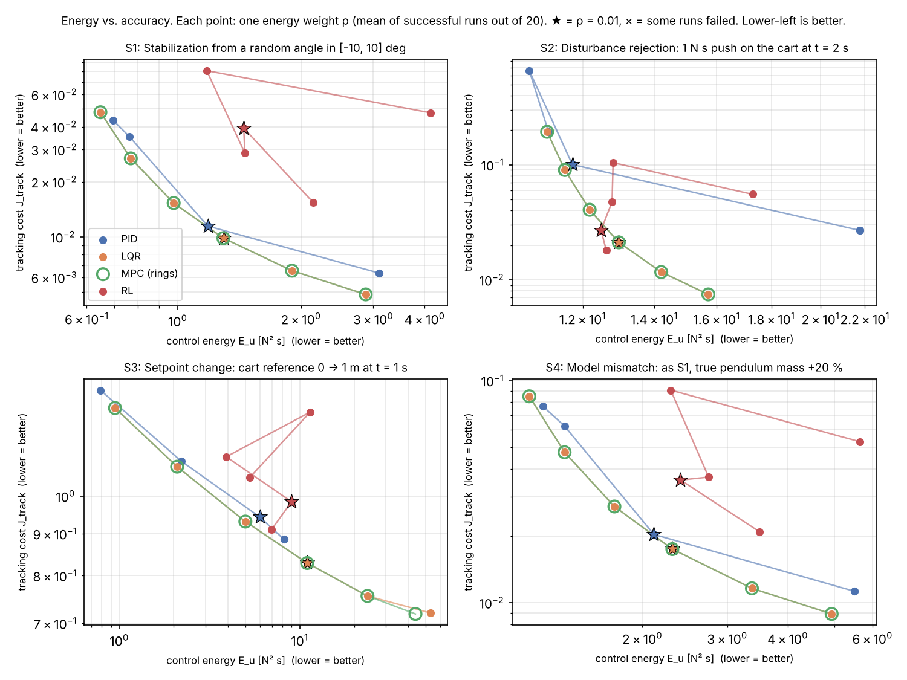

# Energy-Efficient Control of an Inverted Pendulum

PID vs. LQR vs. MPC vs. Reinforcement Learning on a cart-pole system:
which controller keeps the pendulum upright with the least control energy,
at comparable accuracy?

Team project, 2 students, 13 weeks. Python, simulation only.
Report: [`docs/report/report.pdf`](docs/report/report.pdf) ·
Demo video: [`results/demo_video.mp4`](results/demo_video.mp4)

## Results in short

All four controllers balanced the pendulum in **100 % of the 320 test runs**
(4 scenarios × 20 random starts, at every energy weight). The difference is
the energy each one pays for its accuracy:

| Controller | Verdict |
|---|---|
| **LQR** | **Best energy–accuracy trade-off.** On the Pareto front in all four scenarios; 0.003 ms per step. |
| **MPC** (CasADi + qpOASES) | Identical to LQR whenever its limits are inactive (LQR terminal weight). Helps when constraints bind: near the track end it succeeds in 19/36 starts vs. 14/36 for LQR. 0.3 ms per step. |
| **PID** (cascaded, grid-searched) | Close to the front. The grid search rediscovered almost exactly the LQR gains. Saves 8–46 % energy at ρ = 0.01, but always with lower accuracy. |
| **RL** (SAC) | 2–10× the LQR tracking cost at equal energy in S1/S4, but beats the LQR front under pushes (S2, which it saw in training) and was best near the track end (30/36). Needed a reward redesign; large seed-to-seed spread. |

Main numbers at energy weight ρ = 0.01 (mean of 20 runs; energy E_u in N²s / tracking cost):

| | S1 start angle | S2 push | S3 step 1 m | S4 heavier pendulum |
|---|---|---|---|---|
| PID | 1.18 / 0.011 | 11.7 / 0.101 | 6.0 / 0.94 | 2.11 / 0.020 |
| LQR | 1.29 / 0.010 | 13.0 / 0.021 | 11.0 / 0.83 | 2.31 / 0.017 |
| MPC | 1.29 / 0.010 | 13.0 / 0.021 | 11.0 / 0.83 | 2.31 / 0.017 |
| RL  | 1.45 / 0.039 | 12.5 / 0.027 | 9.0 / 0.98 | 2.40 / 0.036 |

Full table: [`results/eval/main_table.md`](results/eval/main_table.md) ·
Pareto fronts: [`results/eval/pareto.png`](results/eval/pareto.png)



## Model

State `s = [x, x_dot, theta, theta_dot]`, `theta = 0` is upright, positive
towards `+x`. Input: horizontal force `u` on the cart. Equations of motion
from the Lagrange method ([`docs/modeling_lagrange.pdf`](docs/modeling_lagrange.pdf)),
verified symbolically with SymPy:

```
x_ddot  = (u + m l th_dot^2 sin th - m g sin th cos th) / (M + m sin^2 th)
th_ddot = ((M+m) g sin th - u cos th - m l th_dot^2 sin th cos th) / (l (M + m sin^2 th))
```

Assumptions: point-mass pendulum, no friction. Gymnasium's `CartPole-v1`
uses the same numbers but a uniform rod, so our RL environment wraps our own
simulator instead.

| Parameter | Value |
|---|---|
| Cart mass M / pendulum mass m | 1.0 kg / 0.1 kg |
| Pivot to center of mass l | 0.5 m |
| Force limit / track limit | ±10 N / ±2.4 m |
| Control period | 0.02 s (50 Hz) |

Linearized around upright: `A[1,2] = −0.981`, `A[3,2] = 21.582`,
`B = [0, 1, 0, −2]ᵀ`, unstable pole at +4.646 rad/s.

## How the comparison is kept fair

* One simulator for all (RK4, 10 substeps, zero-order hold); the simulator
  applies the ±10 N limit, not the controllers.
* Every controller is tuned for the same cost
  `J = ∫ (x − x_ref)² + θ² dt + ρ ∫ u² dt` and swept over
  ρ ∈ {0.001, 0.003, 0.01, 0.03, 0.1, 0.3} to trace its Pareto front.
* Tuning (seed 7) and evaluation (seed 2026) use different initial
  conditions; RL training uses its own random starts.
* Scenarios: S1 random angle ±10°; S2 1 N·s push at t = 2 s; S3 cart
  reference 0 → 1 m at t = 1 s; S4 as S1 with a 20 % heavier pendulum.
  A run fails if |θ| > 30° or |x| > 2.4 m.
* Energy differences vs. LQR are tested with a paired Wilcoxon test.

## Repository layout

```
models/        cartpole.py     dynamics, energy, linearization, discretization
               simulator.py    RK4 simulator, zero-order hold, saturation
               metrics.py      E_u, E_mech, settling time, overshoot, ...
               animation.py    matplotlib animation
controllers/   base.py, pid.py, lqr.py, mpc.py, rl.py   all: u = controller(state, t)
envs/          cartpole_env.py Gymnasium environment (reward with energy penalty)
experiments/   scenarios.py    S1-S4, tuning set, shared cost, run()
               tune_pid.py, lqr_sweep.py, mpc_study.py, train_rl.py,
               train_all_rl.sh, select_rl.py, plot_rl.py, evaluate.py,
               make_video.py, make_report_assets.py, demo_free_fall.py
validation/    sympy_derivation.py, validate_simulator.py
tests/         unit tests (pytest, 17 tests)
results/       pid/ lqr/ mpc/ rl/ eval/ validation/, demo_video.mp4
docs/          report/ (LaTeX + PDF), modeling_lagrange.pdf, meetings.md
```

## How to reproduce

```bash
python -m venv .venv && source .venv/bin/activate   # Windows: .venv\Scripts\activate
pip install -r requirements.txt

# WP1: model and simulator
python -m validation.sympy_derivation
python -m validation.validate_simulator
pytest -q

# WP2-WP4: classical controllers
python -m experiments.tune_pid        # ~3 min, writes results/pid/best_gains.json
python -m experiments.lqr_sweep
python -m experiments.mpc_study       # horizon study + track-limit test

# WP5: RL (about 17 min per agent on one CPU core, 7 agents)
./experiments/train_all_rl.sh         # or: python -m experiments.train_rl --rho 0.01 --seed 0
python -m experiments.select_rl       # best checkpoint on the tuning set
python -m experiments.plot_rl

# WP6: evaluation, then video and report
python -m experiments.evaluate        # ~4 min, results/eval/
python -m experiments.make_video      # needs ffmpeg
python -m experiments.make_report_assets
cd docs/report && latexmk -pdf report.tex
```

Trained agents are included in `results/rl/models/` (`*_best.zip` are the
ones evaluated), so the evaluation can be run without retraining. RL
training is seeded, but PyTorch on different hardware may not reproduce the
exact same agents.

## Status

| Work package | Status |
|---|---|
| WP0 Setup | done |
| WP1 Modeling and simulation | done (validated) |
| WP2 PID | done |
| WP3 LQR | done |
| WP4 MPC | done (linear MPC; nonlinear MPC not implemented) |
| WP5 RL | done (SAC; PPO not trained) |
| WP6 Evaluation | done |
| WP7 Extension (optional) | not done |
| WP8 Report, video, presentation, release | done |

## Acknowledgements

We used AI coding tools for help with parts of the code.

Libraries: NumPy, SciPy, Matplotlib, SymPy, python-control, CasADi, qpOASES, Gymnasium,
Stable-Baselines3, PyTorch.
